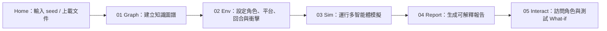
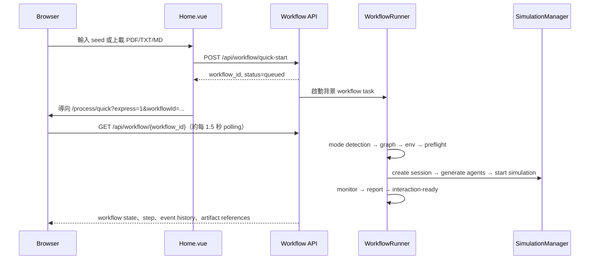
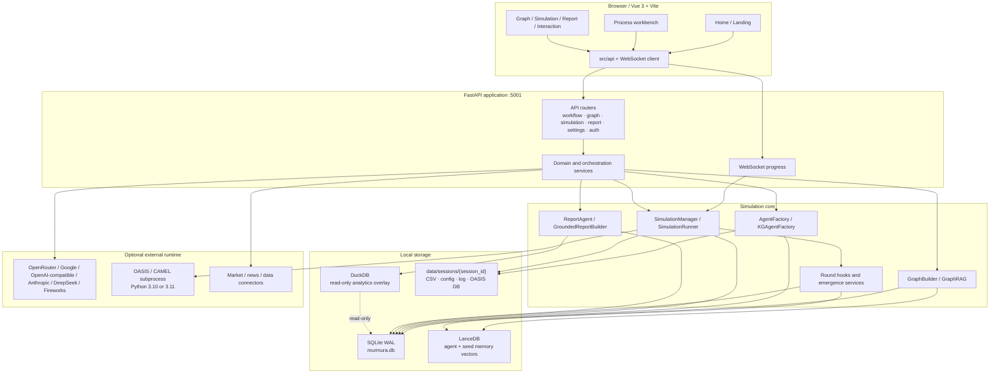

# Murmura 現行架構與產品設計

> **文件狀態：** Current implementation baseline
> **更新日期：** 2026 年 9 月 14 日
> **適用 checkout：** `feat/multi-platform-identity`，baseline `f24f05a` 加上未提交、範圍明確的 research-workbench 更新
> **用途：** 集中記錄現行產品設計、程式架構、資料流，以及已實作但仍未完成 live 驗證的部分。

這份文件以 current checkout 的 source、schema、frontend routes 和現有驗證紀錄為準。它是架構與設計基準，不是 release certification；文件中寫到「已實作」，只代表程式碼存在並已接上相應入口，不等於整條真實外部流程已重新跑通。

這份文件亦涵蓋現時未提交、範圍明確的更新。工作樹刻意保留，不能用固定檔案清單當作長期事實；截至 2026-09-14 的精確改動、驗證記錄和 live 驗證缺口，以 [`reports/implementation_checkpoint.md`](../reports/implementation_checkpoint.md) 和 [`reports/murmura-session-report-2026-09-14.md`](../reports/murmura-session-report-2026-09-14.md) 為準。

## 1. 產品定位

Murmura 是一個通用情境推演工作台。使用者提供一段文字、一份文件或一個問題，系統將它整理成一個可運行的情境世界，再讓不同角色按自己的目標、記憶、信念、關係和限制作出反應。

產品的核心輸出不是一個看似精準的單一答案，而是：

- 情境入面有哪些角色、關係、決策和可能衝擊；
- 角色互動後，哪些狀態和集體模式會改變；
- 哪些路徑相對穩定，哪些結果對假設或衝擊很敏感；
- 每個報告結論由哪些圖譜、行動、信念、記憶或統計結果支持。

Murmura 不應被當成預言工具。模擬頻率、Monte Carlo 分佈和 LLM 解讀，都要保留假設、來源和不確定性，不能直接當成現實世界的準確機率。

預設 quick workflow 是一個 small-world research path：最多 16 個由 seed／KG 得出的角色、5 rounds、單一 Twitter platform，並且不會為湊數而加入 invented background actors。大型 preset、branch、Swarm、Monte Carlo、macro 和其他既有能力仍然保留，但不是第一次探索的預設承諾。

### 1.1 產品承諾

現行產品設計圍繞一條可追問的因果線：

```text
種子材料 → 角色與關係 → 觀察與記憶 → 行動 → 共享環境改變
    → 其他角色下一輪觀察 → 信念／關係更新 → 新行動 → 報告與分支
```

真正值得驗證的湧現，不是文字看起來生動、agent 數量夠多，或者圖表有變化，而是 A 的行動確實進入共享環境，B 下一輪確實看見並改變其輸入，B 的後續行動又令系統走向不同路徑。

### 1.2 不屬於現行承諾的內容

- 不保證任意題材都能產生可靠的現實預測。
- 不把 agent 數量、LLM call 數量或報告字數當成模擬品質。
- 不把 mocked LLM、dry-run 或單元測試結果寫成真實 OASIS live evidence。
- 不將現有的 `Relativity` 規格當成已整合入主產品的功能；該文件仍是 `Proposed`。

## 2. 產品體驗與介面設計

### 2.1 主要使用流程

Murmura 的主要 frontend 是一個五步工作台：



在普通手動流程中，`Process.vue` 按完成條件解鎖下一步：

| 步驟 | 使用者看到的工作 | 主要 frontend component | 主要 backend 入口 |
|---|---|---|---|
| 01 | seed text、文件、persona，上載和圖譜預覽 | `Step1GraphBuild.vue` | `POST /api/graph/build` |
| 02 | 預設 `research` small world，或 advanced preset、agent／round、platform、macro scenario、manual shocks | `Step2EnvSetup.vue` | `POST /api/simulation/preflight`、`POST /api/simulation/create` |
| 03 | round progress、feed、network、macro、faction、shock、graph snapshot | `Step3Simulation.vue` | `POST /api/simulation/start`、WebSocket、simulation query APIs |
| 04 | Markdown 報告、XAI tools、confidence／artifact view、PDF、share | `Step4Report.vue` | `POST /api/report/generate`、`POST /api/report/{session_id}/xai-tool` |
| 05 | report chat、agent interview、memory lookup | `Step5Interaction.vue` | `POST /api/report/chat`、`POST /api/report/interview`；另有受 ownership 保護的 simulation interview API |

每一步都有 loading、error、locked 或 unavailable 狀態。Simulation step 會先讀取 `/api/health` 的 capabilities；如果 OASIS runtime 不可用，UI 應清楚顯示 Simulation disabled，而不是假裝有完成真實模擬。

### 2.2 Express workflow

Home page 的快速入口不會逐頁等待每個 HTTP request，而是：



Express workflow 的 backend 實作位於 `WorkflowRunner`，現時會在 request handler 內以 `asyncio.create_task()` 啟動 runner。這是目前實作方式，不應誤讀成具備獨立 durable worker、lease 或 outbox 的 production queue。

### 2.3 Frontend route map

目前實際註冊的主要 routes：

| Route | 用途 |
|---|---|
| `/` | Home workbench：seed、quick start、domain pack、data connector |
| `/landing` | 公開介紹頁；核心 workbench 不沿用其 marketing 視覺語言 |
| `/process/quick`、`/process/:scenarioType` | 五步工作台 |
| `/simulation/:sessionId` | 單次 simulation run view |
| `/report/:reportId` | 已保存報告 |
| `/interaction/:sessionId` | 報告與角色互動 |
| `/app`、`/app/graph/:sessionId` | Workspace、Graph Explorer |
| `/app/evidence/:sessionId` | Evidence Explorer |
| `/dashboard` | Prediction dashboard |
| `/god-view` | 額外的 simulation／signals terminal view |
| `/settings` | provider、API key、model、UI 設定 |
| `/public/report/:token` | 分享後的公開報告 |

核心 app 採用黑、白、灰、橙的 workbench 視覺語言，使用細邊框、低圓角、compact mono labels、明顯的五步狀態和左右工作區。Landing page 可以有較完整的產品敘事，但不應將 marketing hero 的視覺語言帶回核心 simulation workbench。

所有 frontend user-facing strings 原則上經 `vue-i18n` 的 `zh-TW.js` 和 `en-US.js` 管理；API response 以 `{ success, data, meta }` envelope 為主，frontend 透過 `res.data?.data || res.data` 取出資料。

## 3. 系統總體架構



### 3.1 Backend application lifecycle

`backend.app.create_app()` 建立 FastAPI application，掛載 CORS、slowapi rate limiting、`/api/health` 和 `/api/diagnostics/setup`。startup lifespan 會：

1. 初始化 telemetry 和 logging；
2. 在 demo mode 需要時以 `demo_replay.py` 將明確標示的 scripted flood replay 寫入正常 application tables；
3. 回收上一個 server instance 遺留的 OASIS subprocess；
4. 執行 `init_db()` 和 migrations；
5. 啟動 serialised SQLite write queue；
6. 還原 session cost state 和其他 runtime tables；
7. 掛載 API routers。

shutdown 會嘗試停止 OASIS processes、flush write queue 和停止 scheduler。這層負責程序生命週期，不負責 simulation 的 round logic。

### 3.2 Router 家族

所有 routers 都由 `backend/app/__init__.py` 動態 import 並以 `/api` prefix 掛載。現行 router 家族包括：

- `auth`、`workspace`、`comments`：身份、ownership 和 collaboration；
- `workflow`、`graph`、`reality_seed`：種子輸入、文件 intake 和圖譜；
- `simulation`、`simulation_actions`、`simulation_macro`、`simulation_branches`、`emergence`、`interview`：執行、讀取、分析、分支和互動；
- `report`、`validation`、`calibration`：報告、驗證和校準；
- `domain_packs`、`settings`：情境模板和 runtime 設定；
- `data`、`data_connector`、`stock_forecast`、`prediction_market`：外部資料和附加分析；
- `ws`：simulation progress WebSocket。

## 4. Seed 到報告的實作資料流

### 4.1 Seed intake 和安全處理

Seed 可以由 textarea、PDF/TXT/MD upload 或 Reality Seed 產生器提供。HTTP API 和 service 層會對 source seed、scenario question 和 prompt seed 做 sanitisation，再交給 graph、scenario 或 agent prompt。

上載 quick workflow 的上限是 10 MB；一般 quick-start 的文字上限是 500,000 characters。`ScenarioIntakeService` 負責文件格式和文字抽取，並將後續 pipeline 統一成 seed text。

### 4.2 Step 1：Graph Build

`GraphBuilderService.build_graph_from_seed()` 會：

1. 以 seed text 建立 graph-holder session，使 `kg_nodes` 和 `kg_edges` 的 foreign-key 關係成立；
2. 將 seed 分 chunk，交給 `TextProcessor`／graph extraction 產生顯式 entities 和 relationships；
3. 寫入 `kg_nodes` 和 `kg_edges`，保留 entity type、relation type、description、source text、evidence span 和 confidence；
4. 由 `ImplicitStakeholderService` 找出 seed 沒有直接寫出、但對情境有影響的持份者，最多 50 個，並用 `source="implicit_discovery"` 方式注入；
5. 由 `MemoryInitializationService` 生成 group world context 和 persona templates，寫入 SQLite，並在可用時寫入 LanceDB；
6. 計算 node／edge count、entity types、relation types 和 graph metadata；
7. 如果抽取不到 entities，保留 empty-extraction 結果並清楚提示；不得憑空補一個 fallback graph，假裝世界已建立。

Graph layer 有兩種語義：

- `truth` layer：來自 seed 或明確 evidence 的情境資料；
- `belief` layer：simulation 中 agent 形成的信念邊或節點。

這兩層不可在報告中混成同一種事實。

### 4.3 Step 2：Environment Setup

`ZeroConfigService` 先按 domain keywords 和必要的 LLM fallback 判斷 simulation mode、domain pack 和 time configuration。然後 `SimulationManager.create_session()` 建立 `simulation_sessions` row，保存 agent count、round count、graph id、platform map、scenario question、macro scenario 和 request config。

Agent 生成有兩條路：

| Mode | Agent 來源 | 主要資料 |
|---|---|---|
| `hk_demographic` | `AgentFactory` | domain pack demographic distributions、Big Five、人口和經濟欄位 |
| `kg_driven` | `KGAgentFactory` | KG nodes／edges、seed text、implied actors、goals、capabilities、constraints、beliefs 和 platform identities |

兩條路最後都會寫出 OASIS 所需的 session CSV，並將 agent profile 保存到 `agent_profiles`。`kg_driven` 另外會保存 universal profile properties、platform identities、universal relationships 和 seed memory hydration。

`SimulationPreflightService` 會在真正啟動前檢查：

- Python／OASIS capability；
- provider、model 和 API key 可用性；
- agent count、round count、platform 和 time config；
- simulation readiness、warnings、blocking errors；
- provider-reported usage 以外的成本不可完整預先估算。

Preflight 會回傳 `cost_estimate_unavailable` 和 null numeric values，而不是以 agent × round 的線性公式製造 USD 或 token 數字。它不會因不可靠估算自動暫停 research run；真實 spend 要由使用者的 provider-side budget 和 recorded partial usage 管理。

### 4.4 Step 3：Simulation

`SimulationManager` 是 process-wide singleton，避免不同 API handler 同時為同一 session 重複 spawn。它負責 session state transition、job row、runner config、start／stop／resume 和 agent query。

`SimulationRunner` 將完整 config 寫入：

```text
data/sessions/{session_id}/
  agents.csv
  sim_config.json
  sim.log
  *.db（視乎 OASIS script）
```

它按啟用 platform 選擇 OASIS script：單一 Twitter、Reddit、Facebook 或 Instagram，或者多平台的 `run_parallel_simulation.py`。`SimulationSubprocessManager` 專責 launch、wait、SIGTERM → SIGKILL stop、health monitor 和 RSS memory limit；simulation business logic 留在 `SimulationRunner`。

OASIS 子程序以 JSONL stdout 回傳 progress、post、news shock、complete 或 error。backend 將資料推送到 `/api/ws/progress/{session_id}`，frontend 的 `Step3Simulation.vue` 再更新 feed、log、round counter 和分析 panels。

Twitter／Reddit 的 shipping scripts 會讓 round N 等候 round N-1 的 parent cognition，並只將該 actor 自己的 cognitive state 帶入下一輪 context；native OASIS feed perception 不會被 backend snapshot 取代。受控 scripted Twitter subprocess 已驗證 IPC、SQLite persistence 和 context wiring，但這不是 paid/live model 或 prediction-accuracy 證據。

### 4.5 Step 4：Report

simulation 完成後，`ReportAgent` 透過 structured XAI tools 讀取 graph、actions、sentiment、demographics、macro、agent interviews、platform breakdown、story arcs、debate、emergence 和 validation 等資料，再生成報告。

`GroundedReportBuilder` 負責將 session artifacts 和 deterministic findings 組織成 Markdown，並以已保存的 decision／action IDs 作為 trajectory evidence。報告保存到 `reports`，frontend 可以：

- 讀取 Markdown；
- 要求 XAI tool 對某個角度再查一次；
- 下載 PDF；
- 產生 share token，公開讀取 `/api/report/public/{token}`；
- 以 report chat 追問。

報告應清楚區分 source material、simulation action、tool operation、statistical output 和 LLM interpretation；不能把分析工具本身的操作寫成 stakeholder reaction。

### 4.6 Step 5：Interaction 和 What-if

互動層包括：

- `InterviewEngine`：根據 agent profile、recent memories 和 session context，讓使用者以角色角度提問；
- report chat：對整份報告作 follow-up query；
- manual shock：在運行期間向 session 注入外部衝擊；
- branch：從指定 round 複製 agent profiles、memories、actions 和部分 dynamic state，建立另一條 session；
- Monte Carlo、Swarm Ensemble、multi-run 和 auto-fork：比較不同隨機或 counterfactual 路徑。

Branch 不是單純複製一個 config。按 `fork_round`，現行實作會嘗試複製 belief states、emotional states、relationships、KG edges 和 cognitive dissonance；部分表不存在時會 best-effort skip，因此 branch 的完整 state coverage 要以實際 artifact 檢查為準。

## 5. Simulation engine 設計

### 5.1 Round hook 組織

`HookConfig` 以 frozen dataclass 保存間隔、concurrency、decision cap、Monte Carlo trials 和 emergence toggle。一般結構如下：

```text
每個 round
  ├─ Pre-Group 1：feed ranking；kg_driven 可生成 world event
  ├─ Group 1（可並行）：memory、trust、emotional state、relationship state
  ├─ Group 2（決策序列）：decision、belief update
  │              kg_driven：strategic planning、LLM deliberation、debate、propagation
  └─ Group 3（週期性）：echo chamber、virality、macro、polarization、TDMI
                  kg_driven：faction、tipping、relationship lifecycle、moderation
```

主要週期：

- memory reflection 約每 7 rounds；
- network evolution 約每 3 rounds；
- emotional contagion、virality 約每 3 rounds；
- consensus debate、collective action、news／macro 等按 preset 的 hook config 執行；
- macro、polarization、KG snapshot、echo chamber 多數預設約每 5 rounds，大型 population 會自動放寬；
- `FAST` preset 關閉 emergence hooks，`STANDARD` 和 `DEEP` 開啟。

### 5.2 Cognitive、belief 和 relationship state

agent 可帶有：

- Big Five traits、activity level、influence weight 和 stakeholder flag；
- goals、capabilities、constraints、persona、political／stance axes；
- per-platform identity、tone、audience、anonymity 和 moderation risk；
- beliefs、confidence、evidence count、memory triples；
- VAD emotional state；
- trust、intimacy、passion、commitment、satisfaction、investment 和 attachment style。

`CognitiveAgentEngine` 將上述 context 組成每次 deliberation 的輸入。`BeliefSystem` 做 Bayesian update；`BeliefPropagationEngine` 以 embedding 相似度追蹤觀點傳播；`ConsensusDebateEngine` 週期性處理跨 faction debate；`relationship_engine` 以 deterministic rules 將 personality／attachment 和互動映射到關係狀態。

### 5.3 Network、platform 和 moderation

`MultiLayerNetwork` 為每個 platform 保存獨立的 edge set 和 agent identity。每輪會按時間、activity vector 和 platform identity 選擇 agent 出現的平台。`ModerationEngine` 可產生 delete 或 shadow-ban events，並將結果寫入 platform action log；moderation risk 亦可回饋到 agent 的情緒或後續行動。

預設 research path 只使用 Twitter。Twitter／Reddit 是目前有實作路徑的平台；Facebook 和 Instagram 在 frontend 標示為 experimental，實際可用性仍要看 OASIS script、preflight capability 和 live run。

### 5.4 宏觀、公司與附加 domain logic

`MacroController` 管理宏觀 state、external data points 和 shock feedback。B2B／trade／supply-chain 類 scenario 可由 `CompanyFactory` 動態建立 company profiles，由 `SupplyChainBuilder` 形成供應鏈關係，再按 round 產生 company decisions 和 macro adjustments。

Forecasting 和 research analysis 另有 VAR、GARCH、Monte Carlo／LHS／t-Copula、retrospective validation、Brier、Sobol sensitivity、surrogate model 和 calibration services。這些是分析能力，不應自動等同於每次 simulation 都會被主流程完整執行。

## 6. 資料架構

### 6.1 SQLite 是交易與結果的 canonical store

預設資料庫是 `data/murmura.db`，以 aiosqlite、WAL、foreign keys 和 serialised write queue 處理寫入。舊的 `data/murmuroscope.db` 在符合條件時會自動 migration。workspace 可有獨立的 `data/workspaces/{workspace_id}/murmura.db`。

schema 的主要資料群如下：

| 資料群 | 主要 tables | 作用 |
|---|---|---|
| Seed / graph | `kg_nodes`、`kg_edges`、`kg_communities`、`kg_snapshots` | 情境實體、關係、社群和時間快照 |
| Workflow / execution | `workflow_runs`、`workflow_events`、`simulation_sessions`、`simulation_jobs` | express workflow 狀態、session lifecycle、worker heartbeat |
| Agents | `agent_profiles`、`cognitive_fingerprints`、`platform_identities` | 角色 profile、cognitive context、平台身份 |
| Actions / memory | `simulation_actions`、`platform_actions`、`agent_memories`、`memory_triples` | 行動、平台紀錄、長期記憶和 TKG |
| State evolution | `belief_states`、`emotional_states`、`cognitive_dissonance`、`agent_goal_revisions` | 信念、情緒、認知失調和目標修訂 |
| Social dynamics | `agent_relationships`、`relationship_states`、`attachment_styles`、`agent_feeds`、`network_events` | 信任、關係、feed、網絡演化 |
| Emergence | `echo_chamber_snapshots`、`filter_bubble_snapshots`、`virality_scores`、`polarization_snapshots`、`emergence_metrics` | 同溫層、過濾泡、傳播、極化和 TDMI |
| Cognitive theater | `world_events`、`faction_snapshots_v2`、`tipping_points`、`debate_rounds`、`consensus_scores` | world events、派系、臨界點、辯論和共識 |
| Reports / evaluation | `reports`、`ensemble_results`、`multi_run_results`、`calibration_results`、`validation_runs` | 報告、分佈、multi-run、校準和回溯驗證 |
| Economy / domain | `macro_scenarios`、`market_data`、`company_profiles`、`company_decisions`、`agent_consumption` | 宏觀、市場、公司、供應鏈和消費 |
| Auth / settings | `users`、`workspaces`、`workspace_members`、`prediction_comments`、`app_settings` | ownership、協作、評論和 runtime config |

完整 canonical schema 在 [`backend/database/schema.sql`](../backend/database/schema.sql)。

### 6.2 Canonical identifiers 和容易出錯的欄位

- `simulation_sessions.id` 是 simulation session identity；`sim_mode` 是 mode 欄位，並非 `mode`。
- `kg_nodes.session_id` 和 `kg_edges.session_id` 是 graph/session binding；node title 欄位是 `title`，edge 欄位是 `source_id`、`target_id`、`relation_type`。
- `agent_memories.memory_text` 和 `salience_score` 是現行欄位名稱。
- `simulation_actions.oasis_username` 是 NOT NULL；所有 test fixture 或人工 insert 都必須提供。
- universal KG node IDs 應以 graph prefix 開始；implicit actor ID 使用 `{prefix}_imp_{slug}` 形式。
- `active_metrics` 是 `dict[str, float]`，不是 list。

這些名稱是跨 service、migration、query 和 test 的實際 contract，改動時要先搜尋所有 consumers。

### 6.3 Runtime schema 與 canonical schema 的分界

目前並非所有現行 table 都集中在 `schema.sql`：

- `WorkflowRunner` 會 runtime 建立 `workflow_runs` 和 `workflow_events`；
- startup migrations 會建立 `session_costs`、`personality_evolution_log`、`user_data_points`、`api_data_sources`、`session_api_keys` 等；
- 部分 service 會按需要建立 `macro_snapshots`、`ensemble_trials`、`emergence_scorecards`、`bias_probe_results`、`emergence_alerts`、collective action 和其他附加 tables。

因此，單讀 `backend/database/schema.sql` 未必足以重現一個空資料庫的完整 runtime schema。要驗證 fresh install，必須跑 startup lifecycle 和 migrations，再檢查 SQLite schema。

### 6.4 LanceDB、DuckDB 與 filesystem artifacts

LanceDB 位於 `data/vector_store`：

- `mem_{session_id[:12]}` 保存 agent semantic memories；
- `swc_{graph_id[:12]}` 保存 seed world context；
- embedding unavailable 時，memory service 可退回 SQLite query，但 semantic retrieval coverage 會降低。

DuckDB 是 read-only analytical overlay，直接 attach SQLite file 作 heavy aggregation；所有 transaction writes 仍經 aiosqlite，避免分析查詢阻塞 WAL writer。

simulation 的可重播材料和 subprocess logs 位於 `data/sessions/{session_id}`。`logs/`、`data/sessions/`、`data/vector_store/` 和 frontend build outputs 都屬於 runtime／ignored artifacts，不是 public source contract。

## 7. LLM、設定與外部 runtime

### 7.1 Model routing

`backend/app/utils/llm_client.py` 是統一 LLM wrapper，支援 OpenAI-compatible providers、Anthropic 和 Google REST。常用 routing：

- `AGENT_LLM_PROVIDER`／`AGENT_LLM_MODEL`：agent profile、deliberation 和 simulation decision；
- `LLM_PROVIDER`／`GOOGLE_REPORT_MODEL`：report generation；
- `AGENT_LLM_MODEL_LITE`：lite/background agent；
- `step1` 到 `step5` 的 provider／model override：按 workflow step 覆寫 global fallback。

同一類 LLM client 應使用 module singleton，避免每次 round 重建 client。`chat()` 回傳 `LLMResponse`，`chat_json()` 回傳 raw dict；兩者不是同一個 return contract。

### 7.2 Runtime settings

Settings page 以 `GET/PUT /api/settings` 讀寫 `app_settings`，再更新 in-memory `RuntimeSettingsStore`，所以 model／provider 改動理論上可在下一次 LLM call 生效，不需要 restart server。API keys 在 GET response 會遮罩；BYOK session key 會先於 environment key 讀取。

`POST /api/settings/test-key` 可以用指定 provider/model 做最小 availability check。這個 check 只證明 key／model 的一次請求，不證明完整 workflow 或 OASIS 可用。

### 7.3 OASIS compatibility

OASIS scripts 由 compatible Python 3.10 或 3.11 啟動。`OASISCompatibility` 和 `/api/health` 提供 capability 結果；Python 3.12 或未安裝 OASIS 時，系統可以 graceful degradation，將 Simulation step disable 或按 strict/degraded policy 結束 workflow。

Docker deployment 將 backend 放在 port `5001`，frontend 放在 port `8080`；local Vite frontend 通常使用 port `5173`，並 proxy 到 backend `5001`。Docker data volume 保存 `/app/data/murmura.db` 和其他 runtime artifacts。

## 8. 現況證據與未驗證範圍

以下矩陣刻意將「程式存在」、「測試覆蓋」和「真實外部運行」分開：

| 範圍 | 現有證據 | 現況判斷 |
|---|---|---|
| 架構、routers、frontend routes、schema | current checkout source inspection | **已確認存在**；代表程式結構，不代表全流程成功 |
| 普通五步 frontend flow | `Home.vue`、`Process.vue`、五個 Step components、`WorldWorkspace`、API modules | **已接線**；9 月 14 日有 local/demo browser acceptance，並非 paid/live E2E |
| Express workflow | `WorkflowRunner`、`/api/workflow/quick-start`、workflow events | **已接線**；預設為 `research`，但 request-owned background task 仍是現行限制 |
| Graph build、implicit stakeholder、seed memory | graph、stakeholder、memory services 和相關 tests | **已實作**；empty extraction 不會製造 fallback world |
| Agent generation | AgentFactory、KGAgentFactory、CSV writer、profile persistence | **已實作**；不同 mode 的實際角色質素未由架構文件證明 |
| OASIS subprocess | scripts、compatibility layer、subprocess manager、runner、controlled Twitter JSONL/SQLite run | **adapter 和受控 execution plumbing 已驗證**；完整 external paid/live E2E 仍未驗證 |
| A → B 真實互動鏈 | hooks、memory、feed、action、belief、DB tables、controlled parent-cognition hand-off | **wiring 已受控驗證，但真實 emergence 未證明**；仍必須看到 B 下一輪實際觀察 A 的結果並改變行動 |
| Report、PDF、share、XAI | `ReportAgent`、`GroundedReportBuilder`、report APIs | **已實作**；每種 report mode 的內容品質和來源分類仍需獨立驗證 |
| Branch、Monte Carlo、Swarm、validation | API、services、schema 和 tests | **能力存在**；不代表每次主 workflow 都會自動執行或結果已校準 |
| Demo mode | `demo_replay.py`、normal application tables、local browser readback | **有 scripted flood replay**；它證明 UI flow，並非模型、emergence 或預測證據 |
| Cost tracking | `CostTracker`、`session_costs`、unavailable preflight estimate | **只記錄 partial provider usage，從不 pause execution**；OASIS/CAMEL 和 retry 未完全納入，零記錄不代表免費 |
| Settings access | local first-admin register/login、masked server-side keys、Settings API | **本地 path 已接線並有 UI evidence**；不是 hosted multi-tenant acceptance |
| 歷史 live run | `data/sessions/53ff1232-8874-407d-9e0d-f60f2fdb4e97`、`data/murmuroscope.db` | **有歷史完成證據**；不能直接推論 current HEAD 可重現、結果有用或成本完整 |
| focused backend tests | 9 月 14 日 bounded suite：`126 passed, 4 warnings` | **測試範圍內通過**；仍屬 mocked/offline evidence |
| frontend build／browser acceptance | production build 和 local demo desktop／prior 390px readback | **已作 scoped acceptance**；不是完整 viewport、device 或 production acceptance |

### 8.1 目前最重要的 launch／research gaps

1. **完整 live path 仍要重新建立可重現證據。** 歷史 live run 存在，但 current HEAD、現時 provider config、現時 OASIS runtime 和現時 frontend 未由同一次驗收證明。
2. **Emergence 要有可觀察的 A → B → A chain。** 單純有 actions、dialogue、consensus、charts 或 DB rows 不足以證明 agent-to-agent interaction 真正改變了後續行為。
3. **Demo 只係受控 UI example。** Scripted replay 已可作本地介面 readback，但不得當作模型、emergence 或預測驗收。
4. **Cost ledger 不是完整支出邊界。** Preflight 已停止編造 estimate；OASIS/CAMEL、hooks、report、retry 和長 context 的成本覆蓋仍要逐段量度。
5. **Workflow durability 仍未完整。** Express runner 由 request-owned `asyncio.create_task()` 啟動；server restart 現時會把 interrupted work 標為 failed 並保留 artifacts，但 duplicate task、lease、replay 和 outbox 行為不能當成已解決。
6. **Runtime schema 需要 fresh-install 檢查。** 部分 tables 由 runtime service 建立，若只初始化 `schema.sql`，未必得到與長期運行 instance 相同的 schema。
7. **報告來源分類要繼續收緊。** Source evidence、simulation action、tool activity、推論和研究假設應各自標示，否則 grounded report 會給讀者錯誤的因果印象。
8. **Confidence 和 validation 的缺資料語義要保持保守。** 沒有足夠 evidence 時應回傳 unavailable／unverified，而不是用固定 model-fit、baseline 或 fallback metric 製造看似精準的分數。

## 9. Presets 與資源取捨

| Preset | Agents | Rounds | Emergence | Monte Carlo trials | 主要用途 |
|---|---:|---:|---|---:|---|
| `RESEARCH` | ≤16 eligible source-derived actors | 5 | On | 0 | 預設 small-world research；單一 Twitter，無 background padding |
| `FAST` | 100 | 15 | Off | 30 | demo、smoke test、快速 UI flow |
| `STANDARD` | 300 | 20 | On | 50 | 一般情境分析 |
| `DEEP` | 500 | 30 | On | 100 | 研究型推演 |
| `LARGE` | 1,000 | 25 | On | 200 | 較大規模壓力測試 |
| `MASSIVE` | 3,000 | 20 | On | 300 | heavy simulation |
| `custom` | ≤50,000 | ≤100 | On | configurable | 進階實驗 |

Preset 不提供 USD 或 token estimate。低成本研究流程應優先用少量、差異清楚的角色和 deterministic state update，將 LLM 留給角色解讀、情境抽取和真正有歧義的決策；大量重複 network diffusion、statistics 和 state update 應由本地 deterministic engine 處理。

## 10. 架構決策與後續方向

以下是方向性決定，不能讀成 current checkout 已全部完成：

- 保留現有 FastAPI、Vue、GraphRAG、queue、memory、hooks、OASIS adapter、report 和 numerical analysis；未有證據需要另起一套 parallel engine。
- 將最重要的 research acceptance 收窄為可追溯的 A → B observation chain、可 replay 的 state、可比較的 branch，以及對 assumptions 和 uncertainty 的清楚標示。
- 將 LLM 放在 seed interpretation、actor／scenario extraction、ambiguity resolution 和 report synthesis；重複性高的 round state、network、Monte Carlo 和 statistics 盡量 deterministic。
- 若要強化 workflow durability，應沿用現有資料模型逐步補上 immutable contracts、event／revision／receipt、outbox、lease-aware runner 和 authorized action gate，而不是把它當成已有功能。
- 任何 MiroFish 或其他 upstream code reuse，都要先做 pinned commit、逐檔 license/provenance audit，再決定是否真的補到現有路徑。

## 11. Source map

作為實作入口，以下檔案最值得先讀：

- Application lifecycle：[`backend/app/__init__.py`](../backend/app/__init__.py)
- Express workflow：[`backend/app/api/workflow.py`](../backend/app/api/workflow.py)、[`backend/app/services/workflow_runner.py`](../backend/app/services/workflow_runner.py)
- Graph build：[`backend/app/api/graph.py`](../backend/app/api/graph.py)、[`backend/app/services/graph_builder.py`](../backend/app/services/graph_builder.py)
- Mode、scenario、agent：[`backend/app/services/zero_config.py`](../backend/app/services/zero_config.py)、[`backend/app/services/scenario_generator.py`](../backend/app/services/scenario_generator.py)、[`backend/app/services/kg_agent_factory.py`](../backend/app/services/kg_agent_factory.py)、[`backend/app/services/simulation_manager.py`](../backend/app/services/simulation_manager.py)
- Simulation lifecycle：[`backend/app/services/simulation_runner.py`](../backend/app/services/simulation_runner.py)、[`backend/app/services/simulation_lifecycle.py`](../backend/app/services/simulation_lifecycle.py)、[`backend/app/services/simulation_subprocess_manager.py`](../backend/app/services/simulation_subprocess_manager.py)
- Controlled platform context：[`backend/scripts/round_context.py`](../backend/scripts/round_context.py)
- Emergence hooks：[`backend/app/services/simulation_hooks_kg_driven.py`](../backend/app/services/simulation_hooks_kg_driven.py)、[`backend/app/services/simulation_hooks_agent.py`](../backend/app/services/simulation_hooks_agent.py)、[`backend/app/services/simulation_hooks_macro.py`](../backend/app/services/simulation_hooks_macro.py)
- Reports：[`backend/app/services/report_agent.py`](../backend/app/services/report_agent.py)、[`backend/app/services/grounded_report.py`](../backend/app/services/grounded_report.py)
- Scripted demo：[`backend/app/services/demo_replay.py`](../backend/app/services/demo_replay.py)、[`scripts/demo.sh`](../scripts/demo.sh)
- Persistence：[`backend/app/utils/db.py`](../backend/app/utils/db.py)、[`backend/database/schema.sql`](../backend/database/schema.sql)、[`backend/app/utils/migrations.py`](../backend/app/utils/migrations.py)
- Frontend workflow：[`frontend/src/views/Home.vue`](../frontend/src/views/Home.vue)、[`frontend/src/views/Process.vue`](../frontend/src/views/Process.vue)、[`frontend/src/router/index.js`](../frontend/src/router/index.js)、[`frontend/src/components/WorldWorkspace.vue`](../frontend/src/components/WorldWorkspace.vue)、[`frontend/src/components/Step3Simulation.vue`](../frontend/src/components/Step3Simulation.vue)
- Runtime configuration：[`backend/app/utils/llm_client.py`](../backend/app/utils/llm_client.py)、[`backend/app/services/runtime_settings.py`](../backend/app/services/runtime_settings.py)、[`backend/app/services/simulation_preflight.py`](../backend/app/services/simulation_preflight.py)
- Deployment and commands：[`Makefile`](../Makefile)、[`docker-compose.yml`](../docker-compose.yml)、[`pyproject.toml`](../pyproject.toml)

## 12. 維護規則

當 architecture 有實質改動時，應同步更新本文件的：

- product flow 或 route map；
- Mermaid system／data-flow diagrams；
- service ownership 和 database table map；
- evidence matrix 和未驗證範圍；
- source map 或 execution prerequisites。

如果只係 proposal，應先開 ADR 或 issue，而不是在 `docs/` 維持另一份看似現行的產品設計。只在開始實作、可列出 scope 和驗證狀態時才合併入本文件。每次更新都應保留 snapshot date、branch／commit 和 dirty-tree 限制，令讀者知道這份文件描述的是哪一個 checkout。
